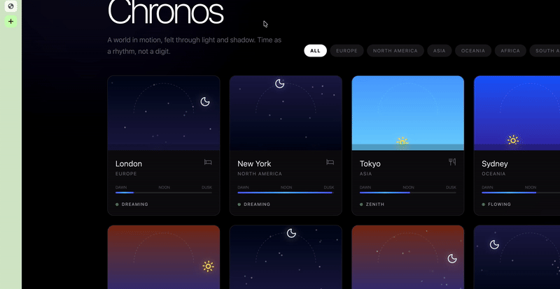
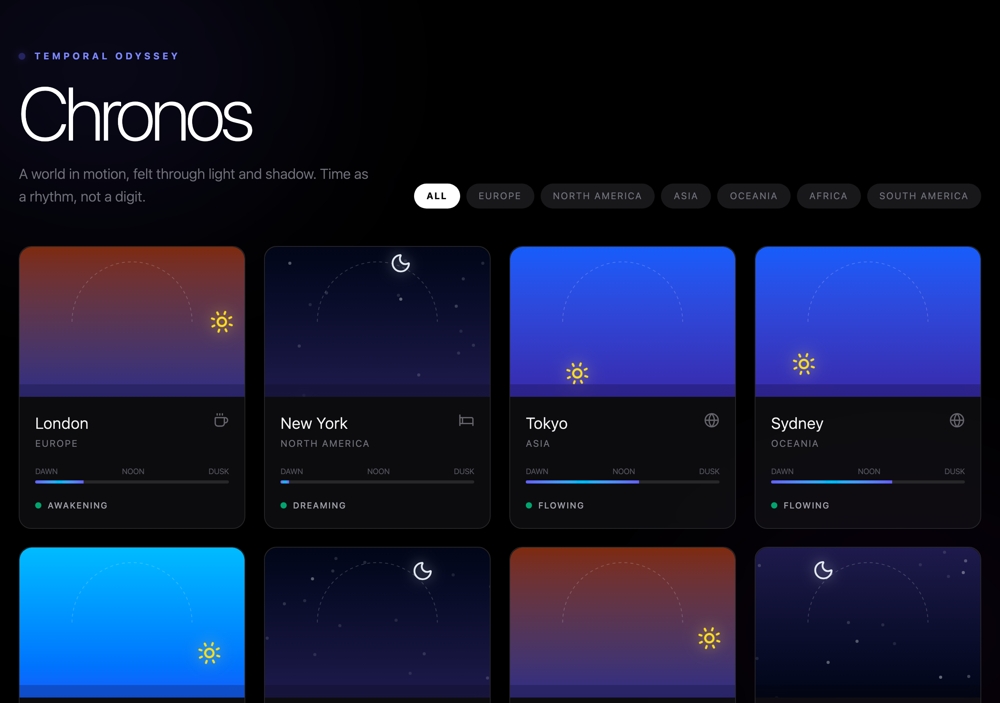
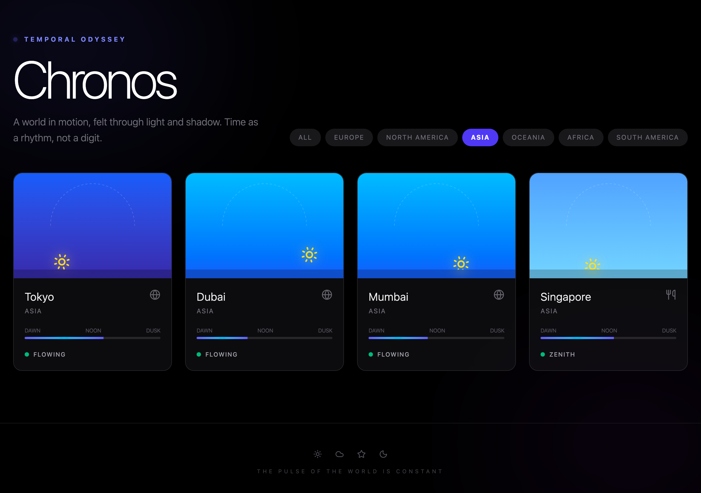

# Chronos Visual Time



A visual time and timezone tracker that beautifully maps the current time in different cities to a stylized sun/moon arc. Watch the sky change colors dynamically based on the local time.

## Quick Start

```bash
git clone https://github.com/AndrewVoirol/ais-remix-chronos-visual-time.git
cd ais-remix-chronos-visual-time
npm install
npm run dev
```

Requires Node.js 18+

## How It Works

Select different cities from the dropdown to instantly see their local time and current sky conditions. The app calculates the fractional time of day for the selected timezone and maps it to a visually pleasing arc. The sky gradient transitions dynamically through dawn, day, sunset, and night states, complete with a rotating sun or twinkling stars.

The sun and moon positions are calculated using simple trigonometric functions along a predefined path, giving a smooth and natural feeling to the visualization.

## Snapshots





## Tech Stack

| Category | Technology |
|----------|------------|
| Framework | React (Vite) |
| Styling | Tailwind CSS v4 |
| Language | TypeScript |
| Icons | Lucide React |
| Animation | Motion |
